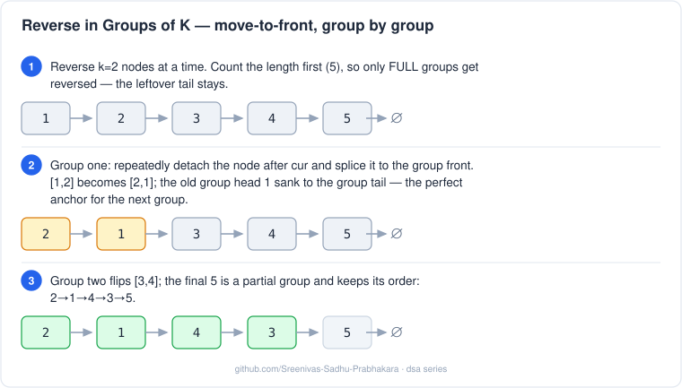

# Reverse Linked List in Groups of K

> Striver SDE Sheet 033 · Day 6 Linked List — count once, then reverse each full group in place by moving nodes to the group front. Go, stdlib only, tested.

## Problem

Reverse a linked list k nodes at a time: the first k nodes become reversed, then the next k, and so on. A leftover group shorter than k keeps its order. k = 2 on `1→2→3→4→5` gives `2→1→4→3→5`.

## Approach

One up-front length count tells how many *full* groups exist, so no group is reversed speculatively and un-reversed. Each group then reverses by the "move to front" maneuver: keep `groupPrev` (the node before the group); k−1 times, detach the node after `cur` and splice it right after `groupPrev`. The first node of the group sinks to the group's tail — making it the natural `groupPrev` for the next round. All splices are local, so the group boundaries never need patching afterwards.

**Complexity:** O(n) time, O(1) space.

## Visual walkthrough

Read the picture top to bottom — each numbered frame is one moment of the algorithm
running on this repo's test example.

## Run

    go test ./...   # verify
    go run .        # demo

---

One of 191 repos solving Striver's SDE Sheet in Go — stdlib only, one problem per repo, every solution tested. Browse the set: [`dsa-*` repos](https://github.com/Sreenivas-Sadhu-Prabhakara?tab=repositories&q=dsa-&type=source).
